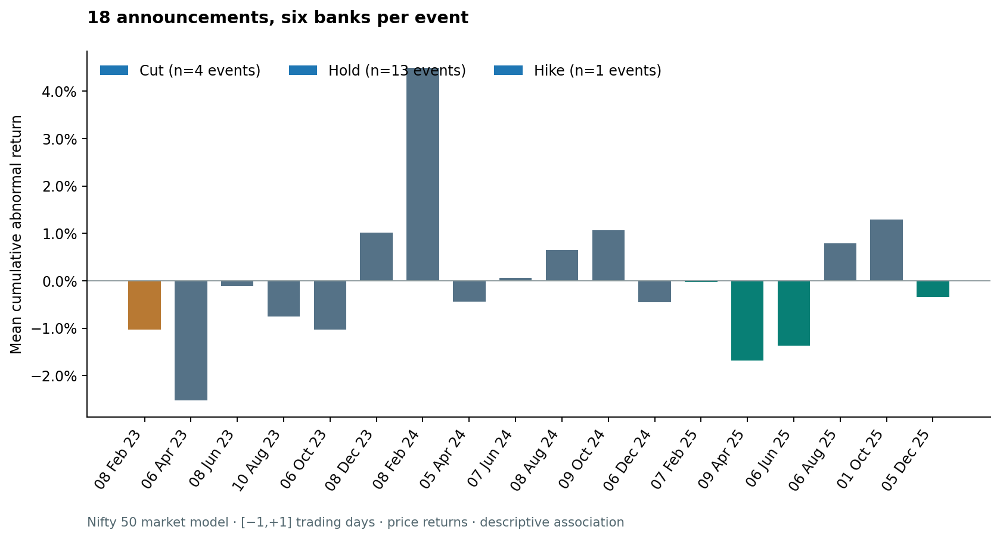

# RBI Banking Market Intelligence

**A reproducible event study of RBI announcements and six Indian banking stocks, with an offline dashboard and a chronological prediction experiment.**

The project asks how banking-stock price returns moved relative to Nifty 50 and Nifty Bank around **18 RBI announcements in 2023–2025**. It combines financial data validation, event-level inference, conditional-volatility forecasts, and an honest evaluation of a small predictive model.

This is an exploratory research portfolio project. It measures historical associations and explicitly reports uncertainty, data limitations, and weak results.

[Research report](outputs/RESEARCH_REPORT.md) · [Data sources](docs/data_sources.md) · [Research design](docs/research_design.md) · [Reproduction guide](docs/reproduction.md) · [Data dictionary](docs/data_dictionary.md)



## Open the project

For the visual result, download [outputs/dashboard.html](outputs/dashboard.html) and open it in a browser. The file contains its own data, styles, and JavaScript; it works offline without a server or account. GitHub shows its source, so use **Download raw file** before opening it.

For the full explanation and numerical findings, read [the generated research report](outputs/RESEARCH_REPORT.md). Every main table and chart is also committed under [outputs](outputs).

## Reproduce everything

The tested environment is **Python 3.12**. Run these commands from the repository root:

```bash
python -m venv .venv
source .venv/bin/activate
python -m pip install -r requirements-lock.txt
python -m rbi_intelligence run
python -m rbi_intelligence verify
python -m pytest -q
```

On Windows, activate with `.venv\Scripts\Activate.ps1` in PowerShell instead. The default analysis uses the committed source snapshots and makes no market-data requests. Package installation needs internet access.

One command regenerates the validated market panel, event-study results, statistical comparisons, dividend sensitivities, 108 event-target volatility forecasts, the prediction evaluation, figures, the report, the dashboard, SQLite, and Tableau/SAS-ready CSVs. Results are staged before replacing the output directory; failed analyses do not publish partial results.

```bash
# Rebuild and validate only the input panel
python -m rbi_intelligence validate-data

# Explicitly retrieve a new source vintage; then regenerate the analysis
python -m rbi_intelligence refresh-data
python -m rbi_intelligence run

# Optional separate output directory
python -m rbi_intelligence run --output-dir outputs-review
```

Refreshing can change historical vendor values. The acquisition is transactional, records the new bytes and timestamps, and preserves the previous raw snapshot if validation fails. Preserve or commit a reviewed snapshot before replacing it. The [run manifest](outputs/run_manifest.json) records source hashes, analysis-code hashes, package versions, settings, and artifact hashes.

## Study at a glance

| Item | Scope |
|---|---|
| Market history | 2021–2025; 1,236 observed market dates |
| Price observations | 9,888 across six banks and two indices |
| Policy events | 18: 13 holds, four cuts, one hike |
| Private banks | Axis Bank, HDFC Bank, ICICI Bank |
| Public banks | Bank of Baroda, Canara Bank, State Bank of India |
| Primary benchmark | Nifty 50 price index |
| Benchmark sensitivity | Nifty Bank price index |
| Estimation | 250 returns, trading days [−255, −6], inclusive |
| Descriptive event windows | [−1,+1], [−2,+2], [−5,+5] trading days |
| Prediction target | Sign of CAR[0,+1], known only after the prediction origin |
| Prediction split | Train 2023–2024: 12 events / 72 rows; test 2025: six events / 36 rows |
| Independent policy units | 18 announcements; the six banks within an event share a policy shock |

## What the corrected results say

The [generated report](outputs/RESEARCH_REPORT.md) is the authoritative numerical summary. It includes effect sizes, uncertainty, unadjusted and Holm-adjusted p-values, model baselines, and dividend sensitivity checks. The figures below come from the committed, fully reproduced snapshot.

<!-- VERIFIED_RESULTS_START -->
- **No cut/hold contrast survives the declared Holm correction.** For Nifty 50 over [−1,+1], the cut-minus-hold difference is −1.1688 percentage points (raw Welch p = 0.0788; Holm p = 0.3115). The Nifty Bank equivalent is −1.0592 pp (raw p = 0.0317; Holm p = 0.1584).
- **Dividends matter to interpretation.** The Nifty 50 primary contrast is −1.0358 pp with adjusted bank returns and −0.9957 pp after excluding window-overlapping corporate actions. The first check mixes adjusted bank returns with a price benchmark; the second changes the bank composition. Neither establishes causality.
- **Prediction does not beat the majority baseline.** On the six 2025 test announcements, the baseline is stronger than either fixed model in the metrics below. These outcomes are retained rather than tuned away.
- **All 108 GARCH fits converge**, but the pooled mean QLIKE is slightly worse than the rolling-variance baseline (GARCH minus rolling = +0.003324; lower is better). Successful optimization alone does not demonstrate better forecasting.

| Model | Accuracy | Balanced accuracy | ROC AUC | Brier score ↓ |
|---|---:|---:|---:|---:|
| Training-majority baseline | 50.00% | 50.00% | 0.5000 | 0.2517 |
| Logistic regression | 33.33% | 33.33% | 0.2407 | 0.3345 |
| Random forest | 47.22% | 47.22% | 0.4691 | 0.2654 |

The test sample is 36 bank-event rows but only **six shared policy events**. Full uncertainty, confusion matrices, and proper scoring rules appear in the [report](outputs/RESEARCH_REPORT.md) and [numerical tables](outputs/tables).
<!-- VERIFIED_RESULTS_END -->

## Data provenance and price conventions

Market observations were actually acquired from **Yahoo Finance Chart JSON**, whose original responses, retrieval records, and SHA-256 hashes are retained. Official RBI releases identify the actual policy announcement dates. NSE archives support a documented repair and selected checks; the project does not claim an independent NSE reconstruction of the whole history.

The rebuilt panel includes the special **1 February 2025** trading session. Yahoo supplied no Nifty Bank OHLCV for that session, so the missing observation is sourced from the official NSE daily index archive. Nifty 50 on the same date and all six bank closes on two dividend-sensitive dates are also checked against official NSE files. See [source evidence and limits](docs/data_sources.md).

Primary simple returns use vendor split-adjusted **Close** prices and price-index benchmarks. `Adj Close` is retained for an explicitly labelled dividend-adjustment sensitivity. There is no forward-filling. Corporate-action diagnostics identify dividends and splits inside each event window, including Bank of Baroda's dividend on 6 June 2025. The project reports both adjusted-bank-return sensitivity and exclusion of affected bank-event observations, with changed sample counts disclosed.

## Analysis methods

**Event study.** Each bank's market model is estimated before the event window. Abnormal return subtracts the estimated market-model expectation from the observed bank return; CAR sums abnormal returns over the declared trading-day window. Both benchmarks use identical inclusive estimation dates. Event-window coverage must be complete.

**Statistical inference.** Comparisons operate on event-level bank averages. Public/private comparisons are paired within the same event. Bootstrap resampling also uses whole events. Declared Holm families cover multiple benchmarks and windows. A single hike cannot support estimation of a hike-group variance; its comparisons remain descriptive. Signed CAR and absolute CAR answer different questions and are reported separately.

**Volatility.** Student-t GARCH(1,1) uses an expanding history ending at the previous trading close. Forecast origin and target are separate fields, and the target is the announcement day. Convergence failures remain visible. A rolling 20-day variance baseline is evaluated on the same observations using a noisy squared-daily-return proxy. Volatility categories use training-period quartiles frozen for 2025.

**Prediction.** Features are restricted to the previous close: prior returns, rolling volatility, aligned GARCH volatility, and bank group. The realised policy decision is metadata, not a feature. Preprocessing fits only on the training sample. Fixed logistic-regression and random-forest specifications are compared with a majority-class baseline whose probability is the training class prevalence. The report supplies accuracy, balanced accuracy, ROC AUC, precision, recall, F1, Brier score, log loss, confusion matrices, and event-resampled uncertainty.

## Repository map

| Location | Contents |
|---|---|
| `rbi_intelligence/` | Maintained Python package and single CLI |
| `data/raw/` | Original source responses, acquisition records, event metadata, corporate actions, repairs, selected exchange checks, consolidated prices |
| `data/processed/market_panel.csv` | Rebuilt return panel; reproducible cache, excluded from Git |
| `outputs/tables/` | Tidy numerical results and sensitivity tables |
| `outputs/figures/` | Four regenerated research figures with explicit units and sample sizes |
| `outputs/dashboard.html` | Complete offline interactive dashboard |
| `outputs/RESEARCH_REPORT.md` | Automatically generated analytical report |
| `outputs/run_manifest.json` | Data/code/output hashes and runtime configuration |
| `outputs/study.sqlite` | Regenerated validated database; excluded from Git |
| `outputs/tableau/` | Tableau-ready and SAS-ready CSV exports |
| `pyspark/`, `sas/`, `sql/` | Optional parity demonstration, independent validation script, and database queries |
| `tests/`, `.github/workflows/` | Regression/invariant tests and reproducible-build CI |
| `docs/` | Methods, data dictionary, source evidence, reproduction, and change notes |

The previous collection of independent scripts and stale result files is retired. Its history remains in Git. The maintained entry point is `python -m rbi_intelligence`.

## Engineering verification

Tests cover real failure modes: corrected event dates, source-file tampering, mismatched calendars, missing observations, exact estimation boundaries, clustered sample counts, corporate-action overlap, future-feature leakage, target/forecast alignment, training-only risk thresholds, failed-fit handling, database rollback, unsafe output destinations, and corrupted exports.

CI installs the locked environment, runs the tests, reproduces the full study offline, and verifies the generated hashes. A separate manually selected job exercises optional PySpark parity. See [verification and commands](docs/reproduction.md) for executed checks and limitations.

The SQLite loader validates before writing and replaces the database only after a successful transaction and integrity checks. Re-running it is safe. The Spark validator reads every partition, checks full key coverage with an outer join, matches null locations, and fails on duplicates, missing rows, or numeric differences.

## Optional tools and honest scope

- **PySpark:** an optional processing-parity demonstration. This small dataset fits comfortably in Pandas; Spark is not a performance necessity. It requires Java 17 and `requirements-spark.txt`.
- **SAS:** a corrected validation script and explicit input exports are supplied. SAS execution requires a SAS installation and is not claimed as part of the Python build.
- **Tableau:** compatible CSVs and a build guide are supplied. No executed `.twb` or `.twbx` workbook is claimed. The delivered visual product is the working HTML dashboard.
- **SQL:** schema, data-quality queries, and descriptive analytical queries operate on the generated database.

## Interpretation limits

Four cuts, one hike, and six held-out prediction events are too few for strong generalisation. All cuts occur in 2025, so policy type is confounded with time and regime. Daily observations also include earnings, macro news, guidance, and other policy announcements. The sector benchmark contains some studied banks and can absorb their common movement.

The data are a later vendor snapshot, not a historical as-of database. Split and dividend treatment, selected bank inclusion, unmeasured policy expectations, and the lack of matched total-return indices limit interpretation. Event-level tests address dependence within an announcement, but do not remove temporal dependence or regime confounding across announcements.

The reconstructed 2025 holdout is retrospective: the outcomes already existed when the project was revised. No new tuning uses the held-out outcomes, but an unchanged model still needs evaluation on genuinely unseen announcements. These outputs support a transparent financial-research project, not a production investment strategy, causal policy effect, or guaranteed forecast.

## Portfolio description

> Built a reproducible Python/SQL event-study pipeline covering 18 RBI policy announcements and six banking stocks, with validated market-data snapshots, event-level statistical inference, past-only GARCH forecasts, chronological model evaluation, and an interactive offline dashboard.

Use this description only if you can explain and reproduce the code, the corrected timing, the weak-sample limitations, and the actual model findings. [Version 2 change notes](docs/CHANGELOG.md) document the rebuild.
